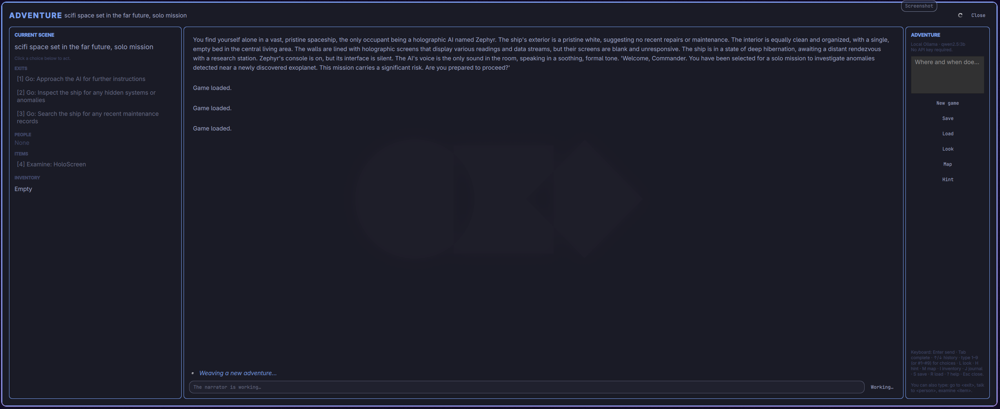

# Adventure for Omarchy

A keyboard-first, AI-powered text adventure for Omarchy. Begin in any place and time, explore a living world, talk with memorable characters, uncover clues, and shape the story through your choices.

Adventure runs fully locally through Ollama. No OpenAI account, API key, internet connection, or cloud billing is required while playing.



## Exploration

Every new adventure opens in a broad named region with at least three meaningful routes. As you travel, the game reveals connected settlements, wilderness, landmarks, and other named locations; the map records routes you have discovered. Ordinary scenes keep at least two ways forward, while true endings and temporary defeats are the only intentional exceptions.

## Requirements

- Omarchy 4.0 (Quattro) with Quickshell plugin support.
- An internet connection during installation so the installer can download Ollama and the model if needed.

## Install everything

This repository is self-contained. Download it from GitHub, open a terminal in the extracted directory, and run:

```bash
bash install.sh
```

The installer checks for Ollama, installs it when missing, enables and starts `ollama.service`, pulls `qwen2.5:3b` when missing, installs this Adventure copy into Omarchy's local plugin directory, moves duplicate or old Adventure copies out of the plugin scan directory, and enables Adventure in the bar.

The model can be changed for testing with an environment variable:

```bash
ADVENTURE_OLLAMA_MODEL=qwen2.5:3b bash install.sh
```

Omarchy plugins run unsandboxed inside the shell process. Install only a copy of this repository that you trust. The installer uses the official Ollama installer only when Ollama is not already installed.

You can also open Adventure from a terminal:

```bash
omarchy-shell shell summon io.github.kszx11.adventure '{}'
```

## Start playing

1. Open Adventure from its bar icon.
2. Make sure the installer reports that Ollama and the model are ready.
3. Describe the place and time for your adventure, then select **New game**.
4. Use the numbered choices or type commands such as `look`, `go to <place>`, `talk to <person>`, or `examine <thing>`.

Adventure sends requests only to Ollama at `127.0.0.1:11434`; no credentials or gameplay data leave your computer.

## Updating

Download the newer repository copy and run `bash install.sh` again. The installer backs up the current Adventure plugin outside Omarchy's plugin scan directory before installing the new copy.

## Remove

```bash
omarchy plugin remove io.github.kszx11.adventure
```

Removing the plugin keeps your saved adventures. If you also want to erase them, delete the `~/.local/state/omarchy-adventure/` directory.
